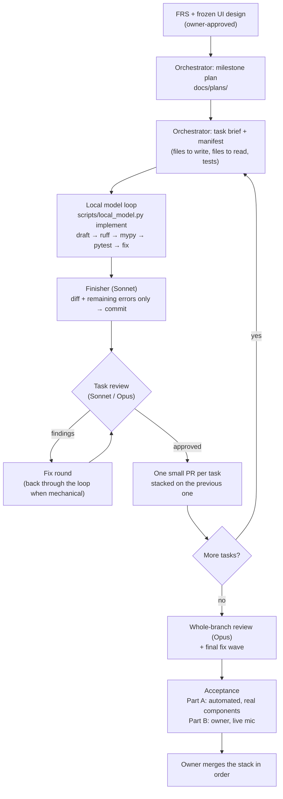

# How Jarvis gets built: the development pipeline

Jarvis is built by AI agents under one human owner. This page describes the setup we actually ran for M1 and use from M2 on: who does what, how the work flows, where tokens are saved, and which gates keep the quality up. For the day-to-day rules (model per task, context budgets, prompts), see [`workflow.md`](workflow.md). For data handling and attribution, see [`policy.md`](policy.md).

Every delegation in this pipeline runs inside the **agent harness** ([`harness/README.md`](../../harness/README.md)). Guides go in before the model acts: the brief, the plan and the house rules. Sensors check what it produced: tests locked after they're written, ruff, mypy, the scope check and review. The harness is the reason a 27B local model can do most of the writing.

## Roles

| Role | Who | Does | Never does |
|---|---|---|---|
| **Owner** | a human | Approves the spec and design. Answers open questions. Runs the live tests that need a person (a mic, a room). Merges PRs. | — |
| **Orchestrator** | Claude Opus, one long session per milestone | Writes the plan and every task brief. Dispatches work, reads reports, makes the small calls ("rulings") so work never waits on the owner, keeps the ledger and `docs/handoff.md` up to date. | Write product code. Merge. |
| **Local model** | Qwen 27B on the owner's desktop GPU (llama-server, OpenAI-compatible API) | Drafts every source and test file of a task, then fixes them against ruff, mypy and pytest in a loop. | See secrets or user data. Run tools. Commit. Write outside its file list. |
| **Finisher** | Claude Sonnet, a fresh subagent per task | Reads only the diff and the remaining errors, finishes what the local model couldn't, verifies, commits. | Redesign the task. |
| **Task reviewer** | Claude Sonnet (Opus for safety-critical code: policy gate, brain isolation, consent) | Reviews one task's diff against its brief. Findings go back for a fix round. | Fix the code itself. |
| **Final reviewer** | Claude Opus | Reviews the whole milestone branch before it's called done. | — |

## The flow



### One task, step by step

1. **Brief.** The orchestrator writes `task-N-brief.md` from [`harness/brief.md`](../../harness/brief.md): the goal, the FRS sections, the interfaces the task must honour, the exact verify commands, and caps on anything that costs money (for example "at most 5 live Claude Code turns"). With it comes a **manifest**: the files to write, the files to read as context, and the pytest targets.
2. **Local loop, always first.** The orchestrator runs `scripts/local_model.py implement` before any Claude agent writes code. A Claude implementer is used only when the brief records an exemption (AGENTS.md rule 15). `scripts/local_model.py implement` sends the brief, the read-only context and the house-rules prompt (`harness/qwen/system.md`) to the local model. It plans first (each requirement mapped to a test), writes the tests and locks them, then writes the implementation one file at a time. It writes each reply, runs `ruff format`/`ruff check --fix`, then `ruff check`, `mypy --strict` and the tests, and feeds the failures back for up to N rounds. No Claude tokens are spent in this loop. It logs every prompt, reply and check, and ends with `summary.json` (`status`: green, red, stalled, scope_violation, test_weakened, test_error or test_disputed; rounds; the weakening events and test disputes; the review's missing requirements; remaining errors).
3. **Finish.** A fresh Sonnet subagent gets the diff, the summary and the remaining errors, not the whole repo. It makes the smallest fixes that get the checks green, runs the verify commands, and commits with a `Co-Authored-By` trailer for each model that wrote code.
4. **Review.** A separate reviewer gets a review package: the brief, the diff, the verify output, and the PR's CI status. A red required job is a finding, even for Linux-only code. It reports findings by severity. Each finding goes back through a fix round until the reviewer approves.
5. **Ledger.** The orchestrator records the outcome, any ruling it made and the follow-ups in its working ledger, then moves to the next task.

When the local model is unreachable, the task goes straight to a Claude implementer. Nothing waits on it.

## Where the tokens are saved

| Lever | Why it works |
|---|---|
| **The local model writes the drafts** | The bulk of the output tokens (whole files, every fix round) are generated on the owner's GPU, not by Claude. |
| **The write–check–fix loop has no Claude in it** | ruff, mypy and pytest are the judges. Only what they can't settle reaches Claude. |
| **The finisher sees only the diff and the errors** | A finisher's context is a few thousand tokens, not the repo. |
| **The reviewer gets a review package** | The brief + diff + verify output, not a repo tour. |
| **Fresh subagent per task** | No context drag from earlier tasks. The orchestrator keeps the long view, and it reads reports, not code. |
| **Rulings instead of round trips** | The orchestrator decides small questions itself, records the reason and the cost of being wrong, and the owner reviews them all at once (`docs/milestones/M1-rulings.md`). |
| **Model per job** | Opus only for planning, safety-critical review and the final review. Sonnet everywhere else. |
| **Caps in briefs** | Anything that bills the owner (live brain turns) has an explicit limit in the brief. |

## Where the quality comes from

Saving tokens is only worth it if nothing gets past the gates. Each layer catches what the one before can't:

1. **Static gates in the loop:** ruff (incl. bandit-style `S` rules), `mypy --strict`, pytest. The local model can't hand over red code.
2. **Hooks:** pre-commit (format, secrets scan, hygiene) and pre-push (mypy + pytest). Claude Code hooks block destructive and review-bypassing commands.
3. **CI on every PR:** static checks, tests on Ubuntu and Windows × Python 3.11 and 3.12, CodeQL, dependency review, PR size (≤ 400 reviewable lines).
4. **Task review** by a different model instance than the one that wrote the code. Opus for the policy gate, brain isolation and consent.
5. **Whole-branch review** before a milestone is called done, then one final fix wave.
6. **Acceptance:** Part A runs scripted commands through the real components (no mocks) and measures latency and idle CPU. Part B is the owner talking to it.
7. **The owner** reads the rulings, runs Part B, and merges.

## M1 in numbers

| | |
|---|---|
| Plan tasks | 13, plus an acceptance fix task and a final fix wave |
| PRs | 100 small stacked PRs (#15 → #114), each reviewed |
| Local model's share of the final lines | Typically 70–100 % per file (lower on tests that needed real-world facts); about 60 % in the final fix wave |
| Local model slips the gates caught | missing or leftover imports, a hand-built `MonkeyPatch`, too many constructor args, tests waiting on an unset event, a queue deadlock after cancel, picking the first item instead of the largest |
| Tests | 1814 passing at the end of M1 |
| Acceptance Part A | 17/17 on real components |
| Rulings for the owner to review | listed in `docs/milestones/M1-rulings.md` |

The Claude-free loop (`scripts/local_model.py implement`) was built at the end of M1. Through M1, a Claude implementer drove the local model file by file and checked its output itself. From M2 on, the loop replaces that driver.

## Running the local model

Any OpenAI-compatible chat server works. Ours:

- **Model:** Qwen 27B, IQ2_M quantisation, 64k context, served by `llama-server` on the owner's desktop GPU (about 33 tokens/s).
- **Network:** reached over a private Tailscale network. The address lives only in each developer's environment (`LOCAL_LLM_URL`), never in the repo.
- **Thinking off:** the script sends `chat_template_kwargs: {"enable_thinking": false}`. With thinking on, the token budget goes into reasoning and the answer comes back empty.
- **Text only:** the local model gets a prompt and returns text. We don't give it a tool-running agent; the script writes the files and runs the checks.

```
export LOCAL_LLM_URL=http://<host>:8080/v1
uv run python scripts/local_model.py ask "List 20 ways a user might say 'volume up'"
uv run python scripts/local_model.py implement --spec brief.md \
    --write src/jarvis/x.py tests/test_x.py --read src/jarvis/y.py \
    --test tests/test_x.py --rounds 5 --log-dir .superpowers/runs/x
```

**Good uses:** whole task implementations from a precise brief, test-case and phrasing lists, synthetic fixtures, docstrings, PR-body drafts.
**Keep away from it:** design decisions, secrets, real user data, anything outside this public repo. Security-relevant code it drafts gets a line-by-line check and an Opus review.

## Rules that keep it safe

- The local model only ever sees text from this public repo and synthetic data.
- It writes only the manifest's files inside the repo, and never commits.
- Agents never merge, approve or close PRs. The owner does.
- Live runs that use the owner's subscription or speakers have explicit caps in the brief, and the volume and any opened apps are restored afterwards.
- Real user data (`~/.local/share/jarvis`, `~/.config/jarvis`, `~/.cache/jarvis`) is never read. Tests and acceptance runs use a scratch `JARVIS_HOME`.

## Working files

The orchestrator's working files (briefs, reports, the ledger, local-model logs) live in a gitignored workspace, `.superpowers/sdd/<plan>/`. What matters long-term is moved into the repo: the plan's status, the rulings, the acceptance report, ADRs and `docs/handoff.md`.
